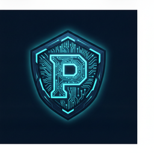

# Scrap Mechanic VAULT mods

  
  
  

  
  
  

Kutay Kılıç — Scrap Mechanic Survival mod paketleri (SM-Bot / VAULT).

İkonlar Gemini (`gemini-2.5-flash-image`) ile V.A.U.L.T. / B.R.E.A.C.H. stiline yakın üretildi (256×256).

## Aktif / önerilen

| | Mod | Klasör | Not |
| --- | --- | --- | --- |
|  | **ItemPump-VAULT** | `mods/ItemPump-VAULT-1.0.0` | noloop MD5 `9171e16adb9e5cfd8a119cf93e47caa4` |
|  | **ClearRain** | `mods/ClearRain-VAULT` | Yağmur alpha ×0.25 |

## Arşiv / iptal

| | Mod | Not |
| --- | --- | --- |
|  | **ItemSorter / Sortbot** | Fazla buggy; kaldırıldı |
|  | **MapViewer-VAULT** | Beacon mesh denemesi; Vortex’ten kaldırıldı |
|  | **BrakeLight-VAULT** | Brake Relay; deploy iptal |
|  | **CookbotSitChest** | Terk; Survival Cookbot vanilla |

## Kurulum

Vortex staging’e ilgili `mods/…` klasörünü kopyala. Oyun açıkken Survival/Vortex dosyası yazma.

## Lisans

Kişisel kullanım; üçüncü taraf Nexus asset kopyası yok (vanilla mesh reuse).
