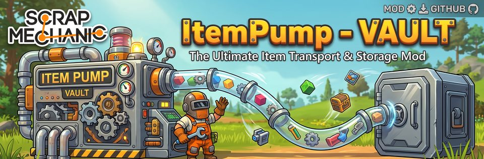
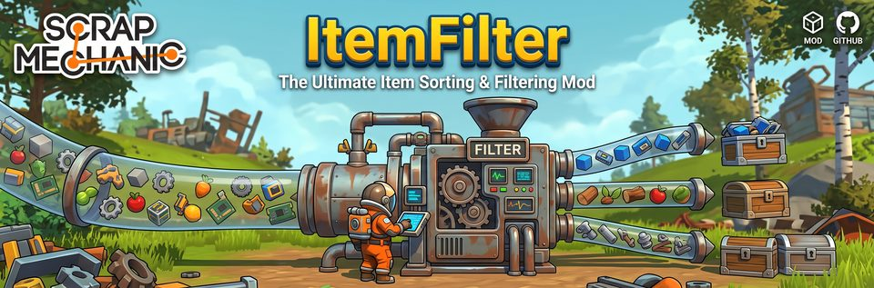

# Scrap Mechanic VAULT mods

  
  
  

Kutay Kılıç — Scrap Mechanic Survival mod paketleri (SM-Bot / VAULT).

## Aktif / önerilen

| Mod | Klasör | Not |
| --- | --- | --- |
| **ItemPump-VAULT** | `mods/ItemPump-VAULT-1.0.0` | noloop MD5 `9171e16adb9e5cfd8a119cf93e47caa4` |
| **ItemFilter** | Vortex `ItemFilter-51-0.0.20260828` (kaynak Kasa’da; bu repoya sonra eklenecek) | MD5 `b8e2e2db683dfcb05da08ca50b8927b7` |
| **ClearRain** | `mods/ClearRain-VAULT` | Yağmur alpha ×0.25 |

## Arşiv / iptal

| Mod | Not |
| --- | --- |
| **ItemSorter / Sortbot** | Fazla buggy; kaldırıldı |
| **MapViewer-VAULT** | Beacon mesh denemesi; Vortex’ten kaldırıldı |
| **BrakeLight-VAULT** | Brake Relay; deploy iptal |
| **CookbotSitChest** | Terk; Survival Cookbot vanilla |

## Kurulum

Vortex staging’e ilgili `mods/…` klasörünü kopyala. Oyun açıkken Survival/Vortex dosyası yazma.

## Lisans

Kişisel kullanım; üçüncü taraf Nexus asset kopyası yok (vanilla mesh reuse).
